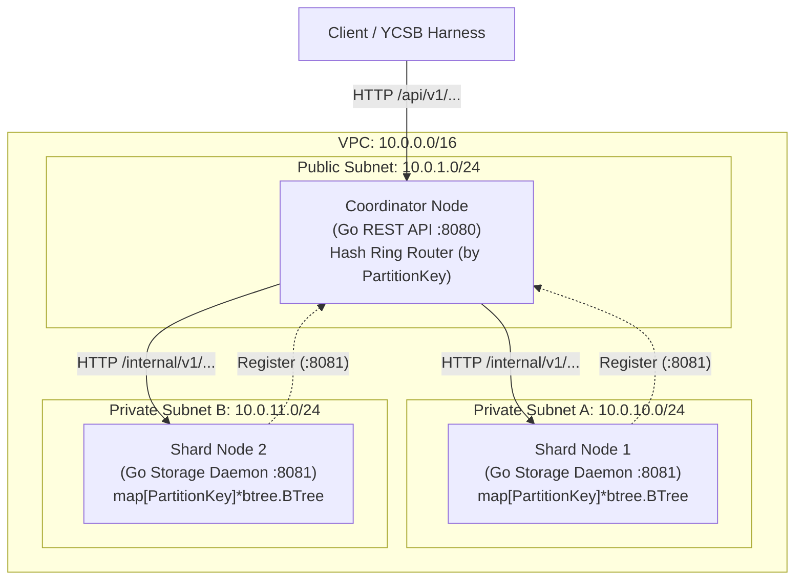

# Design: Milestone 2 — Sharding the Load

## Context
See [proposal.md](file:///home/vasenka88/CloudArch/openspec/changes/m2-sharding-the-load/proposal.md) for motivation and functional capabilities.

Milestone 1 established our foundational networking stack (`infra/network`) with public and private subnets, internet gateway, and IAM analysis within the AWS Academy learner sandbox. Milestone 2 builds upon this infrastructure by implementing a horizontally partitioned distributed key-value store, deploying 1 Coordinator instance in the public subnet and 2 Shard instances in private subnets, managed by OpenTofu and automated via CI/CD.

All components must operate under the strict AWS Academy sandbox constraints:
- `t3.micro` or `t3.small` instance sizes only (max 32 vCPUs).
- EBS volumes restricted to `gp2` with a maximum of 35 GB per volume.
- Strict $100.00 cumulative credit budget ceiling ($32.43/mo for continuous 3-node testing, ~$7.45/mo active testing).
- LabRole limitations requiring remote administration via SSM or SSH keys.

## Goals / Non-Goals

**Goals:**
- Provide an OpenAPI 3.0 compliant REST interface for table registration and CRUD operations (`EXISTS`, `CREATE`, `READ`, `DELETE`), plus intra-partition range queries.
- Implement a Coordinator service that acts as the ingress gateway and manages dynamic shard node topology.
- Implement an in-memory consistent hashing ring with virtual nodes for partition key mapping.
- Implement a standalone storage shard daemon with an in-memory B-Tree partition engine (`map[string]*btree.BTree`) for compound primary keys.
- Support compound primary keys: mandatory Partition Key (hash key) + optional Sort Key (range key).
- Provision the multi-node infrastructure using OpenTofu (`infra/compute`).
- Automate testing, binary builds, and deployment via a GitHub Actions CI/CD pipeline.
- Benchmark the 2-shard cluster with YCSB to establish baseline throughput and tail latency ($p99$).

**Non-Goals:**
- Multi-replica quorum replication and consensus ($R + W > N$) — scheduled for Milestone 3.
- Automatic node failure detection and heartbeating gossiping — scheduled for Milestone 4.
- Dynamic cross-shard data rebalancing and migration — scheduled for Milestone 5.
- Multi-item cross-partition ACID transactions.

## Decisions

### 1. API Protocol and Format: OpenAPI 3.0 REST over HTTP (ADR-0005)
- **Decision**: External client ingress and coordinator-to-shard internal requests use JSON over HTTP/1.1 and HTTP/2.
- **Rationale**: Direct compatibility with standard HTTP benchmark harnesses (YCSB HTTP binding), native support in Go (`net/http`), zero custom driver overhead, and clean alignment with MCP tool schemas in Milestone 4.
- **Alternatives Considered**:
  - *GraphQL*: Rejected due to high parsing overhead for single-key lookups.
  - *Pure gRPC*: Rejected for client ingress due to debugging friction with `curl` and custom YCSB client requirements.

### 2. Hash Function and Virtual Node Strategy (ADR-0007 preview)
- **Decision**: Standardize on **MD5** (or **MurmurHash3-32**) for ring hashing, combined with **150–256 virtual nodes** per physical storage shard.
- **Rationale**:
  - MurmurHash3 and MD5 provide uniform distribution over a 32-bit integer space $[0, 2^{32}-1]$.
  - With only 2 initial physical shards, standard hashing without virtual nodes yields high variance (>30% load imbalance). 150+ virtual nodes per shard reduces partition variance to <5%, ensuring even load distribution during YCSB benchmarks.
- **Alternatives Considered**:
  - *SHA-256*: Rejected due to cryptographic computation overhead without distribution benefits.
  - *Modulo Hashing (`hash(key) % N`)*: Rejected because adding/removing a shard invalidates almost all partition mappings, making dynamic scaling impossible.

### 3. Primary Key Architecture: Compound Keys & B-Tree Storage Engine (ADR-0006)
- **Decision**:
  - Primary keys consist of a mandatory `PartitionKey` (string) and an optional `SortKey` (string, int64, or float64).
  - **Routing Tier**: Coordinator routes requests based *strictly* on the `PartitionKey` via the consistent hashing ring. Sort keys are omitted from ring hash calculations.
  - **Storage Tier**: Storage shards organize partitions using a two-level indexing architecture: `map[string]*btree.BTree` (or Ordered SkipList). The outer map indexes the `PartitionKey`, and the inner B-Tree maintains records sorted by `SortKey`.
  - **Range Queries**: An intra-partition query endpoint (`/api/v1/tables/{table}/query`) allows querying by `PartitionKey` with sort key range bounds (`sortKeyFrom`, `sortKeyTo`, prefix).
- **Rationale**:
  - Strict partition key routing guarantees that all items sharing a partition key reside on the same shard node.
  - Range scans execute locally on a single shard in $O(\log M + K)$ time without costly cross-shard network scatter-gather queries.
  - In-memory B-Trees maximize CPU cache locality, prevent memory fragmentation, and keep memory footprint low on `t3.micro` instances.
- **Alternatives Considered**:
  - *Flat Hash Table with Composite Key (`pk#sk`)*: $O(1)$ point lookups, but range queries require full table scans ($O(N)$).
  - *Two-Level Hash Map (`map[string]map[string][]byte`)*: Sort keys unordered; range scans require $O(M \log M)$ sorting in memory on each request.

### 4. Shard Storage Engine & Local Persistence
- **Decision**: Shard nodes use the in-memory B-Tree engine wrapped with `sync.RWMutex` for concurrent access, backed by periodic snapshotting or an append-only WAL on the local `gp2` EBS volume (`/data/kv-store`).
- **Rationale**: Delivers microsecond read/write execution for YCSB benchmarking while providing crash recovery across process restarts on EBS.

### 5. Infrastructure Layout & Security
- **Decision**:
  - Coordinator instance provisioned in public subnet `10.0.1.0/24` with an assigned Public IP and security group accepting port 8080 (REST API) and port 22 (SSH).
  - Shard instances provisioned across private subnets `10.0.10.0/24` and `10.0.11.0/24` without public IPs.
  - Shard security group allows inbound traffic on port 8081 strictly from the Coordinator security group.
  - Compute instances use `t3.micro` (1 GB RAM, 2 vCPUs) running Amazon Linux 2023 with 20 GB `gp2` root volumes.

### 6. CI/CD Pipeline
- **Decision**: GitHub Actions workflow triggering on push to `master`/`main` and PRs:
  1. `lint & test`: Run `golangci-lint` and `go test -v ./...`.
  2. `build`: Cross-compile static Go binaries for `linux/amd64` (`coordinator` and `shard`).
  3. `infra-check`: Run `tofu fmt -check` and `tofu validate`.
  4. `deploy`: Deploy binaries via SSH/SCP or AWS SSM Run Command to active test EC2 instances.

### 7. YCSB Baseline Benchmarking Methodology
- **Decision**: Execute YCSB using the standard HTTP/REST binding across two standard workloads:
  - **Workload A (50% Read, 50% Write)**: Tests write throughput, lock contention, and request forwarding under heavy update pressure.
  - **Workload B (95% Read, 5% Write)**: Measures peak read throughput and tail latencies ($p50, p95, p99$).
- Metrics collected: Throughput (ops/sec), Average Latency, and $p99$ tail latency.

## Architecture Diagram

## Risks / Trade-offs

- **[Risk] High Partition Skew with Hot Partition Keys** → **Mitigation**: Encourage granular partition keys with high cardinality (e.g. `userId` or `deviceId`); sort keys carry temporal or event attributes.
- **[Risk] Memory Overhead of B-Trees per Partition Key** → **Mitigation**: Lazy initialization of B-Tree nodes per partition; empty partitions are garbage collected; small partitions use lightweight node orders ($B=32$).
- **[Risk] Imbalanced Shard Distribution with Few Nodes** → **Mitigation**: Deploy 150+ virtual nodes per physical shard on the hash ring to guarantee standard deviation of partition assignment remains under 5%.
- **[Risk] AWS Academy 4-Hour Lab Session Termination** → **Mitigation**: EC2 user-data scripts or systemd unit files automatically re-launch services on reboot, and shard state is persisted to EBS.
