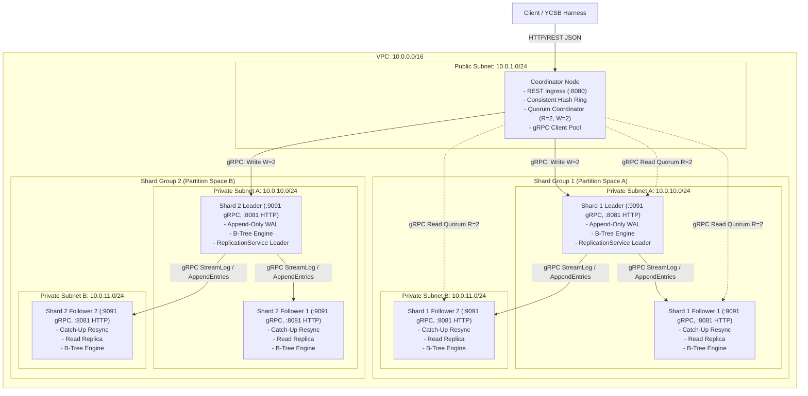

# Design: Milestone 3 — Adding Durability with Replication

## Context
See [proposal.md](file:///home/vasenka88/CloudArch/openspec/changes/m3-durability-replication/proposal.md) for business motivation and functional capabilities, and the capability specs in `specs/` for behavior contracts.

Milestone 2 delivered a horizontally partitioned distributed key-value store with consistent hashing, compound primary keys, and OpenTofu infrastructure. However, each shard was a single point of failure without data redundancy. Milestone 3 expands the architecture by introducing multi-replica sets ($N \ge 3$ replicas per shard) with leader-based event-sourced replication and configurable read/write quorums ($R + W > N$).

All architecture decisions remain bound by AWS Academy sandbox constraints:
- Compute: `t3.micro` instance types (1 GB RAM, 2 vCPUs; 7 instances total = 14 vCPUs, well within the 32 vCPU ceiling).
- Storage: `gp2` EBS volumes (maximum 20 GB per instance, <35 GB ceiling).
- Budget: Strict $100.00 credit ceiling; 7 `t3.micro` instances cost ~$0.073/hour (~$18.00 for 10 days of continuous testing, well below budget).
- Networking: Coordinator in public subnet `10.0.1.0/24`; replica shards isolated across private subnets `10.0.10.0/24` and `10.0.11.0/24`.

## Goals / Non-Goals

**Goals:**
- Provide multi-node durability: survive single-node crashes without data loss ($N = 3, W = 2$).
- Implement a **hybrid communication model**: Client-facing OpenAPI 3.0 REST (JSON) on the Coordinator for external clients, YCSB benchmarks, and Milestone 4 MCP integration; internal high-performance **gRPC + Protocol Buffers** for coordinator-to-shard dispatch and leader-to-follower replication streaming.
- Implement leader-based event sourcing with an append-only Write-Ahead Log (WAL) and monotonic sequence offsets.
- Guarantee strict serializability per partition via single-leader sequencing.
- Support catch-up log resynchronization for restarted or lagging followers over gRPC streaming.
- Implement quorum reads and writes obeying the $R + W > N$ rule ($N = 3, W = 2, R = 2$) to eliminate stale reads.
- Distribute read query load evenly across all active replicas (leader and followers) via multiplexed gRPC connections.
- Implement anti-entropy divergence detection using partition state checksums without full-data log scans.
- Provision 2 shard groups $\times$ 3 replicas (6 shard instances) + 1 coordinator via OpenTofu.
- Benchmark with YCSB Workloads A and B, quantifying replication overhead and tail latency ($p99$) vs M2 baseline.

**Non-Goals:**
- Multi-leader / leaderless multi-master conflict resolution (vector clocks, CRDTs, LWW merge) — scheduled for Milestone 4.
- Automatic distributed leader election via Raft/Paxos — static role assignment or coordinator-assisted failover is sufficient for M3; dynamic consensus and failure recovery belong to Milestone 4.
- Cross-shard rebalancing and dynamic data migration — scheduled for Milestone 5.
- Cross-shard distributed transactions (2PC).

## Decisions

### 1. Hybrid Communication Architecture: REST Ingress + Internal gRPC (ADR-0005 & M3 Update)
- **Decision**: Standardize on a dual-tier protocol topology:
  - **Tier 1 (Client Ingress)**: Coordinator exposes OpenAPI 3.0 REST over HTTP/1.1 and HTTP/2 with JSON payloads. This satisfies external clients, the YCSB benchmark suite HTTP binding, and direct compatibility with Milestone 4 Model Context Protocol (MCP) tool schemas.
  - **Tier 2 (Internal Cluster RPC & Streaming)**: Coordinator-to-shard dispatch and leader-to-follower replication communicate strictly over **gRPC with Protocol Buffers** over HTTP/2.
- **Rationale**:
  - **Protobuf Efficiency**: Eliminates costly JSON text parsing and string allocations on CPU-constrained `t3.micro` instances. Cuts payload serialization overhead by >60%, directly improving $p99$ tail latency during parallel quorum reads/writes.
  - **Multiplexed HTTP/2 Streams**: Long-lived, persistent gRPC channels between Coordinator and Shards eliminate TCP socket exhaustion and handshake latency.
  - **Compile-Time Contract**: Formal `.proto` service interfaces guarantee strict type safety between services.
- **Alternatives Considered**:
  - *Pure REST Everywhere (including internal)*: High JSON serialization overhead and lack of native bi-directional streaming for replication.
  - *Pure gRPC Everywhere (including external client)*: Breaks standard YCSB HTTP drivers and requires custom wrappers for Milestone 4 MCP tools.

### 2. Protocol Buffer Service Contracts (`proto/v1/`)
- **Decision**: Define two core internal gRPC services:

```protobuf
syntax = "proto3";

package cloudarch.v1;
option go_package = "github.com/vasenka88/cloudarch/pkg/proto/v1;v1";

// Internal shard operations invoked by Coordinator
service ShardService {
  rpc GetRecord(GetRecordRequest) returns (RecordResponse);
  rpc PutRecord(PutRecordRequest) returns (RecordResponse);
  rpc DeleteRecord(DeleteRecordRequest) returns (DeleteRecordResponse);
  rpc QueryRecords(QueryRecordsRequest) returns (QueryRecordsResponse);
}

// Replication operations between Leader and Followers
service ReplicationService {
  // Streaming WAL consumption for real-time follower replication
  rpc StreamLog(StreamLogRequest) returns (stream LogEntry);
  // Synchronous append RPC for write quorum coordination (W=2)
  rpc AppendEntries(AppendEntriesRequest) returns (AppendEntriesResponse);
  // Batch catch-up resynchronization for lagging or restarted followers
  rpc SyncRange(SyncRangeRequest) returns (SyncRangeResponse);
  // Anti-entropy state verification
  rpc VerifyState(VerifyStateRequest) returns (VerifyStateResponse);
}

message RecordResponse {
  string table = 1;
  string partition_key = 2;
  string sort_key = 3;
  bytes value = 4;
  uint64 version = 5;
  int64 timestamp = 6;
  bool is_tombstone = 7;
}

message LogEntry {
  uint64 offset = 1;
  uint64 term = 2;
  int64 timestamp = 3;
  string op_type = 4; // "CREATE" or "DELETE"
  string table = 5;
  string partition_key = 6;
  string sort_key = 7;
  bytes value = 8;
  uint32 checksum = 9;
}
```

### 3. Quorum Architecture & Math: $N = 3, W = 2, R = 2$ (ADR-0008)
- **Decision**: Configure each shard partition with Replication Factor $N = 3$, Write Quorum $W = 2$, and Read Quorum $R = 2$.
- **Rationale**:
  - **Quorum Overlap**: $R + W = 2 + 2 = 4 > N (3)$. By the Pigeonhole Principle, any read quorum of size 2 and any write quorum of size 2 must overlap by at least $(R + W) - N = 1$ replica. This overlapping node is guaranteed to hold the latest committed write version.
  - **Fault Tolerance**: The system tolerates 1 node failure ($F = 1$) per replica group for both read and write operations without loss of availability or consistency.
  - **Single-Leader Synergy**: With a single leader sequencing writes, $W = 2$ requires only 1 follower acknowledgment before returning a commit confirmation to the coordinator, minimizing tail latency while providing durability against leader crashes.
- **Alternatives Considered**:
  - *$N=3, W=1, R=3$*: Asynchronous write replication; ultra-low write latency, but followers hold uncommitted writes, leader crash causes permanent data loss, and reads require querying all 3 replicas.
  - *$N=3, W=3, R=1$*: Fast single-node reads, but zero write fault tolerance: a single replica restart blocks all writes.

### 4. Replica Synchronisation Mechanism: Semi-Synchronous Event-Sourcing (ADR-0009)
- **Decision**: Implement semi-synchronous leader-based replication using internal gRPC streaming:
  1. Client sends write (`PUT`, `POST`, `DELETE`) to Coordinator via REST.
  2. Coordinator routes request to the designated Shard Leader via `ShardService.PutRecord`.
  3. Shard Leader appends mutation to its local append-only WAL with monotonic offset $K$.
  4. Shard Leader fans out entry to followers in parallel via `ReplicationService.AppendEntries` (or pushes down active `StreamLog` streams).
  5. Leader awaits $\ge W - 1$ follower durable acknowledgments (total $W = 2$ including leader).
  6. Leader commits the entry to its local B-Tree engine and returns a success response with the committed version to the Coordinator.
  7. Coordinator responds with HTTP 200/201 and record metadata to the client.
- **Rationale**:
  - Semi-synchronous replication guarantees durability across crashes without relying on external message brokers (Kafka/RabbitMQ) which exceed sandbox memory and budget limits.
  - gRPC over persistent HTTP/2 connections in AWS private subnets delivers sub-2ms replication latency.
- **Alternatives Considered**:
  - *External Message Broker (Kafka/RabbitMQ)*: High AWS Academy credit consumption, JVM memory footprint on `t3.micro`, and operational overhead.
  - *S3-backed Log*: High PUT latency (50–100ms) incompatible with high-throughput YCSB benchmarking.

### 5. Log Structure & Ordering Guarantees (ADR-0010)
- **Decision**: Durable append-only binary/Protobuf log format on the shard's local EBS volume (`/data/kv-store/replication.log`).
  - **Ordering Guarantees**: The leader is the single serializer per partition, ensuring strict FIFO sequencing. Offsets are strictly sequential ($1, 2, 3, \dots$).
  - **Idempotency**: Follower log application is idempotent: replaying an offset overwrites state deterministically in the B-Tree engine.
- **Alternatives Considered**:
  - *In-memory only log buffer*: Lost on crash, unable to support restart recovery.
  - *SQLite/Embedded DB*: Higher overhead and write amplification compared to direct append-only file writes.

### 6. Follower Resync & Catch-Up Protocol
- **Decision**: Watermark-based range recovery via `ReplicationService.SyncRange`.
  - Followers store their applied watermark in `/data/kv-store/offset.meta`.
  - On restart or after network reconnection, follower invokes `SyncRange(from_offset = applied_offset + 1, limit = 1000)` on the leader.
  - Leader reads entries sequentially from disk log and streams them back.
  - Follower applies entries to local storage engine, updates watermark, and notifies coordinator when caught up.

### 7. Balanced Read Load Distribution Architecture
- **Decision**:
  - Coordinator maintains the active topology of all $N$ replicas per shard group.
  - On read operations (`GET`, `EXISTS`, `query`), Coordinator selects $R = 2$ distinct replicas via round-robin / randomized permutation across the replica set (both followers and leader).
  - Coordinator issues parallel gRPC `GetRecord` calls to the 2 selected replicas with a short context timeout (e.g. 500ms).
  - When responses arrive:
    - Coordinator selects the record with the highest `Version`.
    - If a tombstone has a higher version than a data payload, Coordinator returns HTTP 404.
  - Read load is distributed across all 3 nodes, yielding $3\times$ single-node read throughput during read-heavy YCSB workloads.

### 8. Anti-Entropy Divergence Detection
- **Decision**: Periodic rolling partition state checksums (`ReplicationService.VerifyState`).
  - Shards maintain an incremental MurmurHash3 checksum of active key-value hashes.
  - Coordinator or background verifier compares checksums across replicas at matching log offsets.
  - If checksums match, replicas are verified consistent without full partition data transfers.
  - If mismatch detected, the follower requests full partition reconciliation.

### 9. Multi-Node Infrastructure Expansion
- **Decision**:
  - OpenTofu manifests in `infra/compute` updated to deploy:
    - 1 Coordinator in public subnet `10.0.1.0/24` (Public IP, REST port 8080).
    - Shard Group 1: 1 Leader (`10.0.10.10`) + 2 Followers (`10.0.10.11`, `10.0.11.10`) running gRPC on port 9091 and HTTP health on 8081.
    - Shard Group 2: 1 Leader (`10.0.10.20`) + 2 Followers (`10.0.10.21`, `10.0.11.20`) running gRPC on port 9091 and HTTP health on 8081.
  - Security groups updated to permit TCP port 9091 internally between Coordinator and Shards and between Shard peers.

### 10. YCSB Benchmarking Strategy
- **Decision**:
  - Re-run Workload A (50% Read, 50% Write) via Coordinator REST API to evaluate write latency overhead from $W=2$ replication.
  - Re-run Workload B (95% Read, 5% Write) to verify read throughput scale-out across 3 replicas.
  - Quantify throughput (ops/sec), average latency, and $p99$ tail latency compared to the M2 baseline.

## Architecture Diagram



## Risks / Trade-offs

- **[Risk: Follower Replication Lag Leads to Stale Single Reads]** → *Mitigation*: Quorum reads require querying $R=2$ replicas via gRPC and resolving by version. Since $R + W = 4 > 3$, at least one replica in the read quorum has the latest write.
- **[Risk: Leader Network Isolation / Partition]** → *Mitigation*: Leader cannot achieve $W = 2$ write quorum without at least one follower acknowledgment; writes safely fail/timeout with HTTP 504, preserving consistency (CP property).
- **[Risk: gRPC Streaming Disconnection]** → *Mitigation*: Follower implements automatic reconnection with exponential backoff; upon reconnecting, it queries `SyncRange` to fill any missed log gaps before resuming live streaming.
- **[Risk: Disk Saturation from Unbounded WAL Growth]** → *Mitigation*: Implement periodic WAL truncation / snapshotting once all replicas have acknowledged offsets beyond a safe checkpoint.

## Migration Plan
1. **Protobuf & Code Generation**: Define `.proto` service contracts and compile Go stubs.
2. **Software Update**: Deploy updated Coordinator (REST ingress + gRPC client) and Shard binaries (gRPC server + HTTP health).
3. **Infrastructure Scale-Out**: Apply OpenTofu compute changes to provision follower instances in private subnets with security group port 9091 open.
4. **Cluster Bootstrapping**: Start leaders first to establish WAL bases, followed by follower nodes registering and initializing sync.
5. **Validation & Verification**: Run integration tests verifying single-node crash survivability, quorum reads/writes, and resync.
6. **Rollback Strategy**: Shard daemons can run in standalone mode if replica configuration is omitted; Coordinator falls back to single-node routing if replica count is 1.
